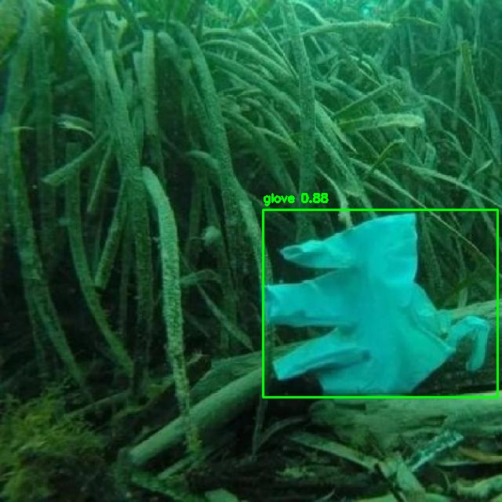

# Marine Debris Detection 🌊🤿

[](https://www.python.org/)
[](https://flask.palletsprojects.com/)
[](https://github.com/ultralytics/ultralytics)
[](LICENSE)

An end-to-end deep learning web application that detects underwater debris and marine garbage (plastic bottles, cans, face masks, gloves, fishing nets, tires, etc.) in images and videos using Ultralytics YOLOv8 and Flask.



---

## ✨ Features
- **15 Detection Classes**: `Mask`, `can`, `cellphone`, `electronics`, `gbottle`, `glove`, `metal`, `misc`, `net`, `pbag`, `pbottle`, `plastic`, `rod`, `sunglasses`, `tire`.
- **Image & Video Inference**: Supports single image uploads and video processing (`.mp4`, `.avi`, `.mov`, `.mkv`) with re-encoding via FFmpeg.
- **Web Interface**: Clean, responsive UI with authentication, detection results viewer, and performance metrics charts.
- **Pretrained Weights Included**: Comes with `best.pt` ready for out-of-the-box inference.

---

## 📁 Project Structure

```text
├── app.py                # Flask application & inference routes
├── best.pt               # Trained YOLOv8 model weights
├── data.yaml             # Dataset configuration for YOLO training
├── training.ipynb        # Jupyter notebook for model training & evaluation
├── requirements.txt      # Python dependencies
├── templates/            # HTML templates for Flask UI
├── static/               # CSS, JS, fonts, and web assets
├── assets/               # Screenshots and media for documentation
├── uploads/              # Temporary upload directory (auto-created)
├── results/              # Directory for annotated images and videos
└── README.md
```

---

## 🚀 Quick Start

### 1. Prerequisites
- **Python 3.8+**
- **FFmpeg** (required for video processing)
  - Windows: `choco install ffmpeg` or `winget install Gyan.FFmpeg` (or download from [ffmpeg.org](https://ffmpeg.org/))
  - macOS: `brew install ffmpeg`
  - Linux (Ubuntu/Debian): `sudo apt update && sudo apt install ffmpeg`

### 2. Clone the Repository
```bash
git clone https://github.com/AdithyaAB/marine-debris-detection.git
cd marine-debris-detection
```

### 3. Set Up Virtual Environment & Install Dependencies
```bash
# Create virtual environment
python -m venv venv

# Activate virtual environment
# Windows (cmd/PowerShell):
venv\Scripts\activate
# Linux / macOS:
source venv/bin/activate

# Install requirements
pip install -r requirements.txt
```

### 4. Run the Web Application
```bash
python app.py
```
Open your browser and navigate to:
```
http://127.0.0.1:5002
```

---

## 🏋️ Training & Dataset

### Dataset
The model was trained on the [Underwater Garbage Detection Dataset](https://universe.roboflow.com/faiza-rehman/underwater-garbage-detection-d4dnn) available on Roboflow Universe (Public Domain):
- **5,095 images** formatted for YOLOv8 (resized to 640x640).

### Retraining the Model
1. Download the dataset into `train/`, `valid/`, and `test/` folders.
2. Train using the Ultralytics CLI:
   ```bash
   yolo detect train data=data.yaml model=yolov8n.pt epochs=50 imgsz=640
   ```
3. Or open and execute `training.ipynb` in Jupyter Notebook / Google Colab.

---

## 🔒 Security & Deployment Notes
- **Authentication**: The built-in user authentication is in-memory for demonstration purposes. Use hashed passwords (e.g. `werkzeug.security`) and a persistent database (e.g., PostgreSQL or SQLite) before deploying to production.
- **Environment Variables**: Configure `SECRET_KEY` and `PORT` via environment variables.

---

## 📄 License
This project is licensed under the [MIT License](LICENSE).
